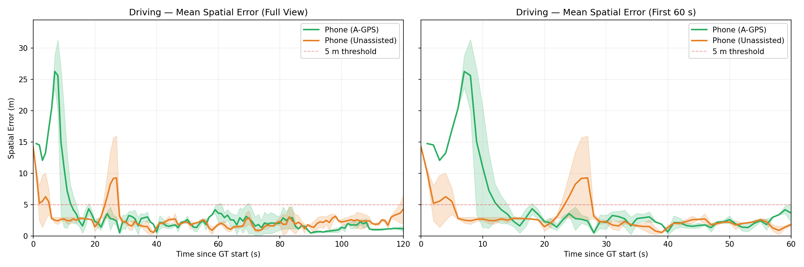
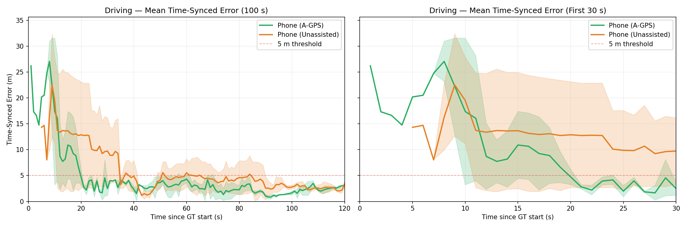
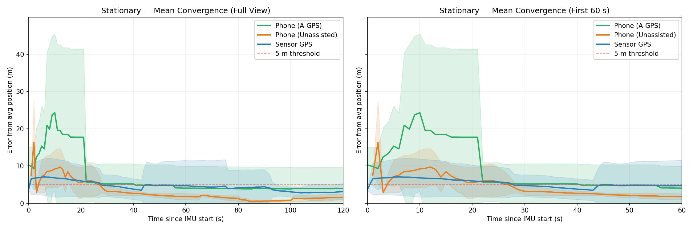

# Assisted GPS Cold-Start Localization | ROS 2 + GPS/IMU Sensor Fusion

**EECE 5554 — Robotics Sensing & Navigation · Northeastern University · Spring 2026**  
**Python · ROS 2 Humble · GNSS · IMU · Extended Kalman Filter · Localization Analysis**

[**Final technical report (PDF)**](Final_Project_Report.pdf) · [**Sensor drivers**](ros2_ws/src/agps_driver) · [**Full analysis / EKF**](full_analysis/analysis.py) · [**Results figures**](figures)

## Overview

Does Assisted GPS (A-GPS) improve *first-fix accuracy*, or mainly reduce time to first fix? This team project investigates cold-start position convergence by comparing an assisted iPhone, the same phone with assistance disabled, and a standalone GlobalSat BU-353S4 GPS / VectorNav VN-100 IMU setup with Python-based EKF sensor fusion.

We collected **10 stationary trials** (five per phone condition) and **four driving trials** (two per phone condition) near Northeastern University's Boston campus, comparing spatial and time-aligned localization errors.

## System pipeline

```text
GlobalSat BU-353S4 GPS ── NMEA GPGGA ── gps_driver.py ── /gps/fix (1 Hz) ──┐
                                                                          ├─ Python EKF + analysis ── trajectories and error metrics
VectorNav VN-100 IMU ──── VNYMR serial ── vn100_driver.py ── /imu (40 Hz) ─┘

Phone (A-GPS on/off) ── phyphox logs ─────────────────────── comparison / evaluation
```

- **GPS:** serial NMEA parsing to `sensor_msgs/NavSatFix`, on `/gps/fix`.
- **IMU:** serial VN-100 message parsing to `sensor_msgs/Imu`, on `/imu`.
- **Launch:** `agps_launch.py` starts both ROS 2 sensor nodes with configurable serial ports.
- **EKF:** `run_ekf()` is implemented **inside** [`full_analysis/analysis.py`](full_analysis/analysis.py), not as a separate ROS 2 node. It estimates east/north position, velocity, and heading.
- **Evaluation:** compares assisted vs unassisted smartphone fixes against approximate reference positions; reports spatial and time-synchronized errors.

## Key findings

- Assisted GPS generally provided an earlier first position estimate, but that first estimate was **not consistently more accurate** in these trials.
- Unassisted phone positioning could exhibit greater short-term temporal lag during motion.
- After convergence, both smartphone conditions had comparable error distributions; the custom sensor-fusion estimator showed stable early positioning in the reported driving tests.
- These results depend on tested hardware and conditions; the reference phone itself has localization uncertainty.

See the [report](Final_Project_Report.pdf) for plots, evaluation details, and limitations.

## Selected results







## Repository guide

```text
RSN_Final_Analysis/
├── README.md
├── Final_Project_Report.pdf
├── ros2_ws/src/agps_driver/       # ROS 2 GPS and IMU source package
├── full_analysis/
│   ├── analysis.py                # extended analysis incl. EKF
│   └── analysis.ipynb
├── figures/                      # selected result figures
├── RSN Final Data Smartphone/    # existing smartphone logs
├── Trial2/                       # existing project data
└── plots/                        # existing GPS result visualization
```

The ROS 2 driver, EKF analysis, and selected figures above were recovered from a separate `EECE5554` project branch. The original repository files and their existing Git history can remain intact.

## Build the ROS 2 drivers

Developed for **Ubuntu 22.04 and ROS 2 Humble** with serial-attached sensor hardware.

```bash
sudo apt install python3-serial
cd ros2_ws
source /opt/ros/humble/setup.bash
colcon build --packages-select agps_driver
source install/setup.bash
ros2 launch agps_driver agps_launch.py
```

Serial ports and permissions must be configured for your hardware. See [`agps_launch.py`](ros2_ws/src/agps_driver/launch/agps_launch.py) for port arguments. The sensor nodes require actual compatible hardware or serial emulation.

## Running the analysis

The expanded analysis code is [`full_analysis/analysis.py`](full_analysis/analysis.py). It imports NumPy, Matplotlib, SciPy, `rosbags`, and OpenPyXL; its input paths were written for the original `FinalProject/data` layout. **The subset provided in this portfolio repository may not include every ROS bag and CSV file needed to rerun it unchanged.** Reconfigure its data paths and supply the relevant experimental recordings before execution.

```bash
python -m pip install numpy matplotlib scipy rosbags openpyxl
python full_analysis/analysis.py
```

The earlier smartphone-only scripts remain in `RSN Final Data Smartphone/Driving/` and may have different input requirements.

## Limitations

- Reference smartphone positioning is not survey-grade ground truth.
- Smartphone proprietary sensor fusion prevents fully isolating A-GPS effects.
- Trial count was limited, especially while driving.
- IMU gravity compensation, drift, serial setup, and time synchronization affect measurements.

## Team and credits

**Berke Yaman · Joseph Horwitz · Michael Chu**  
Northeastern University, EECE 5554; instructor **Yasin Yazıcıoğlu**. Report dated April 23, 2026.

This was a collaborative project. Preserve original source authorship and appropriately credit contributors. Before making data or code public, confirm consent and review all logs for potentially sensitive location or device information.
